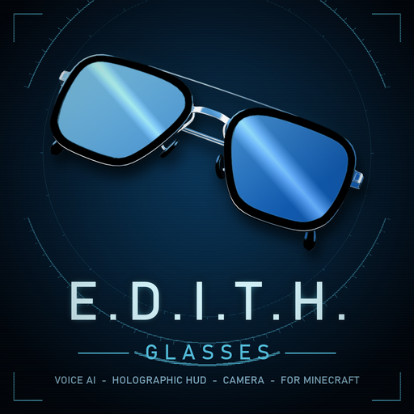

# E.D.I.T.H. Glasses (Fabric, Minecraft 26.2)

Turns the spyglass into smart glasses: a holographic HUD, a voice assistant, vision modes, a cinematic camera and a lot
more. Client-side Fabric mod. Includes a Chat Translator.



## Highlights

- **Glasses**: a 3D glasses model (worn on the head, held in a case), Shift+scroll zoom, `/wear` and `/unwear`.
- **Holographic HUD**: compass, radar, hologram terrain map, target data, threat rating, boot animation, movable parts
  (`/edith layout`). Opens a single custom settings menu with **G**.
- **Voice assistant**: push-to-talk (**V**) with speech-to-text, chat and text-to-speech. Works with Groq, Gemini,
  OpenAI, Anthropic, OpenRouter, Mistral, DeepSeek, xAI, Cerebras, Together AI or a local Ollama model. Spoken lines are
  cached on disk.
- **Vision**: night vision, thermal vision (living things), ore overlay.
- **Facial recognition** with your own tags ("Law Leader", "Enemy"...), **memory** (notes and what is in the chests you
  opened), waypoints, translation subtitles.
- **Camera mode** (**C**): viewfinder, nine looks, exposure, frames, timer, burst, 360 degree panorama, free camera.
  Photos are saved in `screenshots/edith`.
- **House builder** (`/edith build starter|normal|luxury`): hologram preview, then EDITH builds it.
- **Protection** (optional): Sentinel, auto-heal, water bucket clutch.

> **Server rules:** several features automate your character or show hidden information (Sentinel, auto-heal,
> clutch, builder, thermal vision, ore overlay). Many multiplayer servers forbid that. Use them in single player or where
> they are allowed.

## Requirements

- Minecraft **26.2**, Fabric Loader **0.19.5+**, Fabric API **0.161.0+**
- Java **25**
- Optional: ffmpeg (film voice filter), a microphone, API keys (see below)

## Install

Put the jar in your `mods` folder next to Fabric API. Press **G** in game.

## API keys

Add keys in the game (G > AI) or put them in `config/edith-keys.json`:

```json
{ "groq": "", "gemini": "", "openai": "", "anthropic": "" }
```

Keys never leave your computer except in requests to the service you chose. Never commit this file.

## Build

```
./gradlew build
```

The jar is written to `build/libs/`. The optional menu theme (dark holographic GUI) is generated from your own copy of
the game and is not stored in this repository:

```
python tools/gen_menu_theme.py <path to minecraft-client.jar>
```

## Project layout

- `src/main/java/com/example/edithglasses` - the mod (`feature/` has the individual features, `ai/` the assistant)
- `src/main/java/com/example/chattranslator` - the Chat Translator
- `src/main/resources` - models, textures, language files, mixin configs
- `tools/` - scripts that generated the models, textures and several patches (kept for reference)
- `logo/` - the logo and banner, and the scripts that made them

## AI disclosure

This project was developed with the help of generative AI (Claude, by Anthropic). The code, models and textures
were generated and iterated with it, and reviewed and tested by the author.

## Licence

MIT, see [LICENSE](LICENSE). Third-party material: see [CREDITS.md](CREDITS.md).
